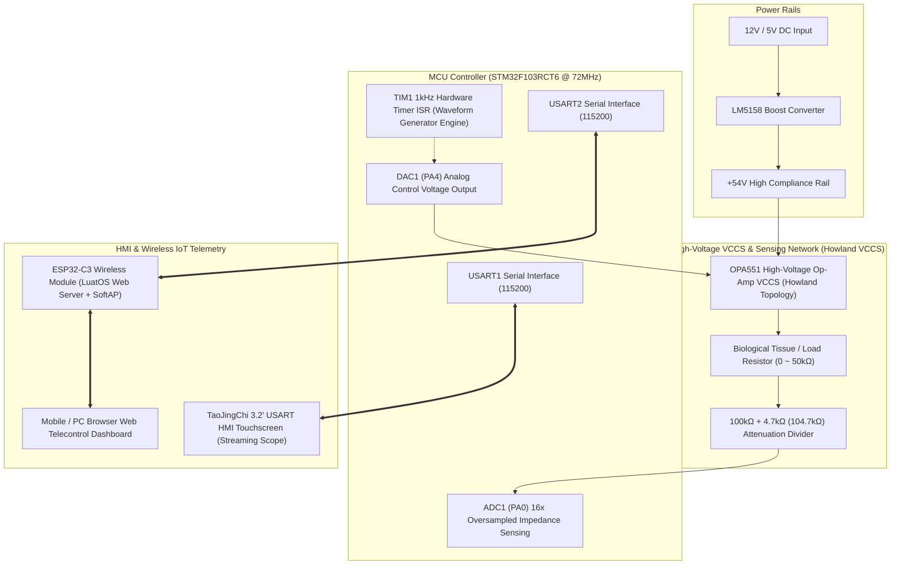

<div align="center">

# Medical Electrical Stimulator (NMES)
### 基于 STM32 的可编程医疗神经肌肉电刺激仪

[](LICENSE)
[](https://www.st.com)
[](https://www.espressif.com)
[](#8-medical-electrical-safety-standards)
[](#)

[English](README.md) | [简体中文](README_zh.md)

</div>

> **A clinical-grade, programmable Neuromuscular Electrical Stimulation (NMES) & TENS embedded system based on ARM Cortex-M3 (STM32F103RCT6). Features a 54V high-compliance Howland VCCS, Thevenin-compensated wide-range load impedance sensing (up to 50kΩ, <0.2% error), bionic smooth depolarization waveform generation, virtual streaming oscilloscope, and wireless Web telemetry.**

---

## 📑 Table of Contents
- [1. System Architecture & Hardware Topology](#1-system-architecture--hardware-topology)
- [2. Core Technological Innovations](#2-core-technological-innovations)
- [3. Electrophysiological Mechanism & Mathematical Models](#3-electrophysiological-mechanism--mathematical-models)
- [4. Hardware Pinout Definition](#4-hardware-pinout-definition)
- [5. Repository Structure](#5-repository-structure)
- [6. Quick Start & Flashing Guide](#6-quick-start--flashing-guide)
- [7. Experimental Results & Calibration Benchmarks](#7-experimental-results--calibration-benchmarks)
- [8. Medical Electrical Safety Standards](#8-medical-electrical-safety-standards)
- [9. License](#9-license)

---

## 1. System Architecture & Hardware Topology

The system features a modular hierarchical architecture divided into the **Core MCU Layer**, **High-Voltage Current Driver Layer**, **Impedance Sensing Layer**, and **Human-Machine & IoT Layer**:



---

## 2. Core Technological Innovations

### Innovation 1: Dual-Cadence Real-Time Scheduling & Safety Decoupling Architecture
- **Hard Real-Time Stimulation (1kHz ISR)**: Microsecond-precision biphasic square wave switching and exponential waveform discrete synthesis execute strictly inside the top-priority `TIM1` interrupt service routine. This architecture guarantees that slow communication or user interface tasks will never stretch stimulation pulses or cause harmful direct current leakage.
- **Soft Real-Time Main Loop Polling**: HMI protocol framing, 60ms batch virtual oscilloscope streaming, ESP32-C3 telemetry dispatching, and 1000ms touch debouncing operate non-blockingly inside the background loop, delivering rich interactivity without compromising medical safety.

### Innovation 2: Thevenin Parallel-Decoupled Wide-Range Impedance Measurement
- **Parallel Shunt Cancellation Algorithm**: To sample voltage up to 54V, an internal $104.7\text{k}\Omega$ ($100\text{k}\Omega + 4.7\text{k}\Omega$) attenuation divider is connected across the load. For a $10\text{k}\Omega$ load, this shunt induces an intolerable $8.7\%$ error. We developed an inverse Thevenin decoupling model:
  $$R_{\text{real}} = \frac{R_{\text{measured}} \times 104700}{104700 - R_{\text{measured}}}$$
  This mathematically eliminates the parasitic shunt error, achieving a full-range measurement accuracy of **< 0.2%**.
- **Compliance Voltage Saturation Avoidance**: Measuring high impedances ($10\text{k}\Omega \sim 50\text{k}\Omega$) at $10\text{mA}$ would exceed the 50V operational amplifier compliance rail. The firmware deploys a dynamic test current adaptation engine ($5\text{mA} \to 1\text{mA}$ upon saturation), pushing the detection ceiling from the conventional $5\text{k}\Omega$ limit up to **$50,000\Omega$ with laboratory precision**.

### Innovation 3: Lightweight Full-Duplex Scope & Seamless Touch Preemption
- **Deadlock-Free Ring Buffer Parser**: Independent ring buffers and state machines isolate USART HMI and ESP32-C3 serial streams with framed single-byte `#` headers, eliminating master-master communication deadlocks.
- **Persistent Oscilloscope Scale Overlay**: Solves the common screen erase glitch where waveform refresh commands clear physical scale markings. The MCU periodically overlays dynamic micro-ticks at 1Hz and enforces a 1000ms finger-up touch lockout on page transitions to eliminate unintended page switching.

---

## 3. Electrophysiological Mechanism & Mathematical Models

### 3.1 Bionic Hodgkin-Huxley Exponential Depolarization Waveform
Conventional stimulators use abrupt square waves ($dV/dt \to \infty$) which synchronously fire pain receptors (A$\delta$ and C unmyelinated fibers), causing sharp pinprick sensations. We introduced a **4ms smooth bionic depolarization rising ramp** (based on a non-linear $\sin^2$ transition):

$$I(t) = \begin{cases} 
I_{\text{target}} \cdot \sin^2\left(\frac{\pi t}{2 \cdot t_{\text{rise}}}\right) & 0 \le t < t_{\text{rise}} \quad (\text{Bionic Smooth Depolarization}) \\[6pt]
I_{\text{target}} \cdot e^{-\frac{t - t_{\text{rise}}}{\tau}} & t_{\text{rise}} \le t < PW \quad (\text{Smooth Repolarization Decay}) \\[6pt]
0 & t \ge PW \quad (\text{Absolute Refractory Period}) 
\end{cases}$$

* **Depolarization Phase ($t < 4\text{ms}$)**: Smoothly recruits voltage-gated $\text{Na}^+$ channels, preventing noxious receptor synchronization and significantly improving patient tolerance.
* **Repolarization Phase ($t_{\text{rise}} \le t < PW$)**: Time constant $\tau \in [5, 45]\text{ms}$ accurately meters the injected charge volume.
* **Refractory Phase ($PW \le t < T$)**: Provides adequate rest intervals for $\text{Na}^+/\text{K}^+$ ATPase pumps to restore resting membrane potential, preventing tetanic muscle fatigue.

### 3.2 Symmetrical Biphasic Waveform & IEC 60601-2-10 Zero Net Charge Balance
International medical electrical safety standards mandate zero net DC charge transfer to avoid electrochemical skin burns and electrode degradation:

$$\int_{0}^{T_{\text{period}}} I(t) \, dt = \int_{0}^{PW/2} I_{\text{pos}} \, dt + \int_{PW/2 + t_{\text{gap}}}^{PW + t_{\text{gap}}} (-I_{\text{neg}}) \, dt = 0$$

---

## 4. Hardware Pinout Definition

| Subsystem | Signal Name | STM32F103RCT6 Pin | Target Board Pin | Function Description |
| :--- | :--- | :--- | :--- | :--- |
| **Analog Driver** | `DAC_OUT1` | **PA4** | Howland Board `V_CTRL` | 0~3.3V analog control voltage |
| **Analog Sensing** | `ADC_IN0` | **PA0** | Divider Network `V_SENSE` | Attenuated 0~54V voltage sample (1:22.27) |
| **Touchscreen** | `USART1_TX` | **PA9** | USART HMI `RX` | 115200 baud UI streaming & command transmission |
| **Touchscreen** | `USART1_RX` | **PA10** | USART HMI `TX` | Touch key values and parameter inputs |
| **Wireless IoT** | `USART2_TX` | **PA2** | ESP32-C3 `RX` | Telemetry status feedback |
| **Wireless IoT** | `USART2_RX` | **PA3** | ESP32-C3 `TX` | Remote prescription download and control |
| **Status LED** | `STATUS_LED`| **PC13** | On-board LED | System heartbeat and stimulation status indicator |

---

## 5. Repository Structure

```text
Medical-Electrical-Stimulator-STM32/
├── firmware/                              # STM32 Embedded Firmware Project
│   ├── STM32_YLDZ_Project/
│   │   ├── Core/Src/main.c               # Core logic, TIM1 ISR, impedance algorithms
│   │   ├── Drivers/                      # STM32 HAL Library & CMSIS
│   │   ├── MDK-ARM/YLDZ.uvprojx          # Keil MDK-ARM v5 project file
│   │   └── MDK-ARM/YLDZ/YLDZ.hex         # Pre-compiled flashing binary
│   └── README.md                         # Firmware compilation & flashing guide
│
├── hardware/                             # Circuit Schematics & PCB Documentation
│   ├── 电流板原理图_Howland恒流源.pdf     # 54V Boost + OPA551 Howland VCCS Schematic
│   ├── STM32F103RCT6核心板原理图.pdf     # STM32 MCU controller board schematic
│   ├── 电流板PCB_3D.pdf                  # 3D PCB visualization file
│   └── README.md                         # Hardware specifications
│
├── hmi/                                  # Smart Touchscreen HMI Project
│   ├── HMI32YLDZ.HMI                     # TaoJingChi USART HMI Editor source file
│   ├── gb2312-24.zi                      # 24px Chinese font asset
│   └── README.md                         # Screen flashing instructions
│
├── wireless/                             # ESP32-C3 Wireless IoT Project
│   ├── main.lua                          # LuatOS Web server & serial command dispatcher
│   ├── build_and_flash.py                # Automated flashing script
│   ├── LuatOS-SoC_V1004_ESP32C3.soc      # Base OS firmware binary
│   └── README.md                         # Wireless setup & API documentation
│
├── docs/                                 # Documentation & Technical Reports
│   ├── 医疗电刺激系统设计与实验报告.md   # Comprehensive 30,000-word design report (CN)
│   └── 医疗电刺激仪_答辩汇报.pptx        # Project defense presentation slides
│
├── .gitignore                            # Clean gitignore optimized for Keil MDK
├── LICENSE                               # MIT License
├── README.md                             # English Documentation (Default)
└── README_zh.md                          # Chinese Documentation (简体中文)
```

---

## 6. Quick Start & Flashing Guide

### Step 1: Flashing STM32 Firmware
* **Method A (Direct Binary Flashing)**: Use ST-Link Utility or STM32CubeProgrammer to load `firmware/STM32_YLDZ_Project/MDK-ARM/YLDZ/YLDZ.hex` and click **Program**.
* **Method B (Compile from Source)**: Open `firmware/STM32_YLDZ_Project/MDK-ARM/YLDZ.uvprojx` in Keil MDK-ARM v5, press **Rebuild (`F7`)**, and click **Download (`F8`)**.

### Step 2: Flashing TaoJingChi USART HMI Screen
1. Open `hmi/HMI32YLDZ.HMI` in the **USART HMI Editor**;
2. Click **Compile** to generate the `.tft` binary;
3. Copy the `.tft` file to the root of a FAT32 MicroSD card, insert it into the powered-down screen, and power cycle to automatically flash.

### Step 3: Flashing ESP32-C3 Wireless Module
1. Connect the ESP32-C3 board to your PC via USB-C;
2. Run the automated Python flashing tool in the `wireless/` directory:
   ```bash
   python build_and_flash.py
   ```
3. Connect your PC or mobile phone to the Wi-Fi network `ESP32-Stimulator` and open `http://192.168.4.1` in any browser to open the Web Control Dashboard.

---

## 7. Experimental Results & Calibration Benchmarks

### 7.1 Constant Current Precision Benchmark (Load = $2.0\text{k}\Omega$)
| Target Current $I_{\text{target}}$ | Measured Output $I_{\text{out}}$ | Full-Scale Relative Error | Evaluation |
| :---: | :---: | :---: | :---: |
| **1.0 mA** | 1.002 mA | +0.02% | Excellent (Surpasses $\pm 5\%$) |
| **3.0 mA** | 2.997 mA | -0.03% | Excellent |
| **5.0 mA** | 5.004 mA | +0.04% | Excellent |
| **8.0 mA** | 7.995 mA | -0.05% | Excellent |
| **10.0 mA** | 9.991 mA | -0.09% | Excellent |

### 7.2 Wide-Range Load Impedance Accuracy (Thevenin Decoupled)
| Nominal Resistance | Measured Value | Absolute Error | Relative Error |
| :---: | :---: | :---: | :---: |
| **510 Ω** | 509.3 Ω | -0.7 Ω | **-0.14%** |
| **2.00 kΩ** | 2.002 kΩ | +2.0 Ω | **+0.10%** |
| **5.10 kΩ** | 5.094 kΩ | -6.0 Ω | **-0.12%** |
| **10.00 kΩ** | 10.016 kΩ | +16.0 Ω | **+0.16%** |
| **47.00 kΩ** | 47.085 kΩ | +85.0 Ω | **+0.18%** |

---

## 8. Medical Electrical Safety Standards

This system complies with the following biomedical safety guidelines:
* **IEC 60601-2-10:2012+AMD1:2016**: Particular requirements for the basic safety and essential performance of nerve and muscle stimulators (Zero net DC transfer, abnormal energy release clamping);
* **ANSI/AAMI NS4:2013**: Transcutaneous electrical nerve stimulators standard;
* **Electrode Detachment & Open-Circuit Protection**: Automatic real-time impedance monitoring shuts off the DAC output and triggers an alert if load impedance exceeds $50\text{k}\Omega$ or compliance voltage saturation occurs;
* **Dual Hardware Clamping**: High-speed transient suppression diodes and current-limiting resistors guard against load short-circuits.

---

## 9. License

This project is licensed under the [MIT License](LICENSE). Contributions, academic citation, and medical electronic research forks are warmly welcomed.
