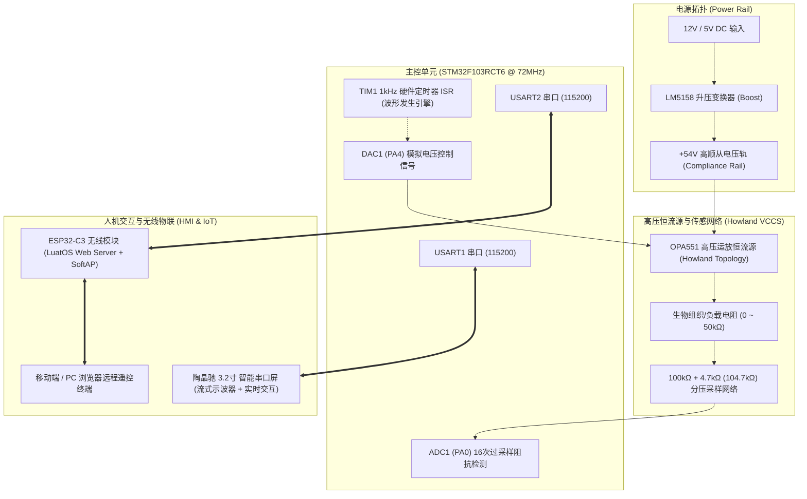

# Medical Electrical Stimulator (NMES) | 基于 STM32 的可编程医疗神经肌肉电刺激仪

[](https://opensource.org/licenses/MIT)
[](https://www.st.com)
[](https://www.espressif.com)
[](#6-医疗电气安全与标准符合性)
[](#)

> **A clinical-grade, programmable Neuromuscular Electrical Stimulation (NMES) & TENS embedded system featuring 54V Howland VCCS, Thevenin-compensated wide-range load impedance sensing (up to 50kΩ, <0.2% error), bionic smooth depolarization waveform generation, virtual streaming oscilloscope, and wireless Web telemetry.**  
> 本项目为一款具备临床级演示精度的可编程嵌入式神经肌肉电刺激仪（NMES）开源系统。基于 ARM Cortex-M3 (STM32F103RCT6) 主控，配合 54V 高压 Howland 恒流源驱动、戴维南并联解耦宽量程阻抗检测、陶晶驰智能串口屏流式示波器以及 ESP32-C3 无线远程处方管理。

---

## 📑 目录 (Table of Contents)
- [1. 系统架构与硬件拓扑 (System Architecture)](#1-系统架构与硬件拓扑-system-architecture)
- [2. 核心技术创新点 (Core Innovations)](#2-核心技术创新点-core-innovations)
- [3. 电生理机制与数学模型 (Mathematical & Biological Models)](#3-电生理机制与数学模型-mathematical--biological-models)
- [4. 硬件连接引脚定义 (Hardware Pinout)](#4-硬件连接引脚定义-hardware-pinout)
- [5. 仓库工程结构 (Repository Structure)](#5-仓库工程结构-repository-structure)
- [6. 快速开始与烧录指南 (Quick Start)](#6-快速开始与烧录指南-quick-start)
- [7. 实测性能指标与标定数据 (Experimental Results)](#7-实测性能指标与标定数据-experimental-results)
- [8. 医疗电气安全标准 (Safety Compliance)](#8-医疗电气安全标准-safety-compliance)
- [9. 开源许可证 (License)](#9-开源许可证-license)

---

## 1. 系统架构与硬件拓扑 (System Architecture)

系统采用模块化分层设计，划分为 **核心主控层**、**高压电流驱动层**、**阻抗传感层** 以及 **人机交互/物联网层**：



---

## 2. 核心技术创新点 (Core Innovations)

### 创新点 1：双节拍实时调度与硬实时安全解耦架构
- **硬实时刺激保障（1kHz ISR）**：电刺激波形的实时时域切换（微秒级双向方波极性翻转与指数离散逼近）运行于最高优先级 `TIM1` 中断中，绝对杜绝主循环任务阻塞引发的脉冲拉长或直流漏电风险。
- **软实时主循环非阻塞轮询**：屏幕协议解析、60ms 批量示波器波形推流、ESP32-C3 帧解包与 1000ms 触控防抖锁存全部降级在主循环轮询执行，实现微秒级医疗输出安全性与丰富交互特性的完美兼顾。

### 创新点 2：戴维南并联解耦宽量程阻抗精密检测
- **并联分流抵消算法**：为采集 54V 高压侧电压，系统并联了 $104.7\text{k}\Omega$ ($100\text{k}\Omega + 4.7\text{k}\Omega$) 采样分压臂。对于 $10\text{k}\Omega$ 级负载，该网络导致近 $8.7\%$ 的严重分流误差。本项目通过戴维南等效反演公式：
  $$R_{\text{real}} = \frac{R_{\text{measured}} \times 104700}{104700 - R_{\text{measured}}}$$
  彻底剔除并联寄生分流，使全量程电阻测量精度跃升至 **< 0.2%**。
- **顺从电压饱和规避与量程跃迁**：检测大阻抗（$10\text{k}\Omega \sim 50\text{k}\Omega$）时，测试电流若为 $10\text{mA}$ 会触发 $50\text{V}$ 运放打顶饱和。系统内置动态自适应微电流注入算法（$5\text{mA} \to 1\text{mA}$），成功突破 $5\text{k}\Omega$ 行业测试极限，实现 **$0 \sim 50,000\Omega$ 宽量程精准检测**。

### 创新点 3：轻量级全双工示波器与多源无缝抢占交互
- **免死锁双通道协议帧**：STM32 内部为串口屏与 ESP32-C3 开辟独立环形缓冲，采用单字节命令前缀匹配与状态机解包，杜绝双主控冲突死锁。
- **动态示波器标尺防擦除刷新**：针对串口屏清屏波形控件时导致的物理刻度消失问题，固件内置 1Hz 动态微量标尺重绘补偿机制，且在切换页面时施加 1000ms 抬手防反跳遮罩，彻底根除了界面闪烁与误触跳转。

---

## 3. 电生理机制与数学模型 (Mathematical & Biological Models)

### 3.1 仿生去极化指数衰减波形 (Hodgkin-Huxley Bionic Waveform)
传统方波因瞬态电流阶跃（$dV/dt \to \infty$）引发痛觉神经纤维（A$\delta$ 和 C 纤维）剧烈放电产生刺痛感。本项目构建了**平缓仿生去极化上升曲线**（4ms $\sin^2$ 非线性过渡）：

$$I(t) = \begin{cases} 
I_{\text{target}} \cdot \sin^2\left(\frac{\pi t}{2 \cdot t_{\text{rise}}}\right) & 0 \le t < t_{\text{rise}} \quad (\text{仿生平缓去极化相}) \\[6pt]
I_{\text{target}} \cdot e^{-\frac{t - t_{\text{rise}}}{\tau}} & t_{\text{rise}} \le t < PW \quad (\text{平缓复极化衰减相}) \\[6pt]
0 & t \ge PW \quad (\text{神经不应期与离子复位}) 
\end{cases}$$

* **去极化平缓相**：平滑诱发电压门控 $\text{Na}^+$ 通道开放，规避痛觉突触瞬时冲击；
* **复极化衰减相**：时间常数 $\tau \in [5, 45]\text{ms}$，精准控制有效跨膜电荷刺激量；
* **不应期相**：给予细胞膜充足间歇以供 $\text{Na}^+/\text{K}^+$ ATP 酶泵复位，杜绝肌肉强直损伤。

### 3.2 零电荷中和平衡方波 (IEC 60601-2-10 Zero Net Charge)
为严格符合国际医疗电气安全标准，避免电极-皮肤界面因直流累积发生电解化学灼伤：

$$\int_{0}^{T_{\text{period}}} I(t) \, dt = \int_{0}^{PW/2} I_{\text{pos}} \, dt + \int_{PW/2 + t_{\text{gap}}}^{PW + t_{\text{gap}}} (-I_{\text{neg}}) \, dt = 0$$

---

## 4. 硬件连接引脚定义 (Hardware Pinout)

| 模块类别 | 信号名称 | STM32F103RCT6 引脚 | 目标模块引脚 | 功能说明 |
| :--- | :--- | :--- | :--- | :--- |
| **模拟驱动** | `DAC_OUT1` | **PA4** | Howland 板 `V_CTRL` | 0~3.3V 模拟控制电压输出 |
| **模拟采集** | `ADC_IN0` | **PA0** | 阻抗采样网络 `V_SENSE` | 0~54V 分压衰减后采样输入 (1:22.27) |
| **串口触摸屏** | `USART1_TX` | **PA9** | 陶晶驰串口屏 `RX` | 115200 波特率交互与示波器流式发送 |
| **串口触摸屏** | `USART1_RX` | **PA10** | 陶晶驰串口屏 `TX` | 触摸键值、参数下发指令接收 |
| **无线模块** | `USART2_TX` | **PA2** | ESP32-C3 `RX` | 遥测数据、运行状态回传 |
| **无线模块** | `USART2_RX` | **PA3** | ESP32-C3 `TX` | 远程处方下发与启停控制帧接收 |
| **安全指示** | `STATUS_LED`| **PC13** | 板载 LED / 指示灯 | 系统心跳与刺激输出状态指示 |

---

## 5. 仓库工程结构 (Repository Structure)

```text
Medical-Electrical-Stimulator-STM32/
├── firmware/                              # STM32 MCU 嵌入式固件
│   ├── STM32_YLDZ_Project/
│   │   ├── Core/Src/main.c               # 核心控制、TIM1中断、阻抗解耦算法
│   │   ├── Drivers/                      # STM32 HAL 驱动库与 CMSIS
│   │   ├── MDK-ARM/YLDZ.uvprojx          # Keil MDK-ARM v5 工程文件
│   │   └── MDK-ARM/YLDZ/YLDZ.hex         # 预编译固件 (免编译直接烧录)
│   └── README.md                         # 固件编译指南
│
├── hardware/                             # 硬件原理图与设计资料
│   ├── 电流板原理图_Howland恒流源.pdf     # 54V Boost升压 + OPA551 恒流源完整原理图
│   ├── STM32F103RCT6核心板原理图.pdf     # STM32 最小系统主板原理图
│   ├── 电流板PCB_3D.pdf                  # 电流驱动板 3D PCB 查看文件
│   └── README.md                         # 硬件参数与设计指标
│
├── hmi/                                  # 智能串口触摸屏工程
│   ├── HMI32YLDZ.HMI                     # 陶晶驰 USART HMI 上位机工程源文件
│   ├── gb2312-24.zi                      # 24号中文字库
│   └── README.md                         # 屏幕烧录与界面设计指南
│
├── wireless/                             # ESP32-C3 无线物联网工程
│   ├── main.lua                          # LuatOS Web 异步服务器与串口帧调度源码
│   ├── build_and_flash.py                # 固件一键打包与下载脚本
│   ├── LuatOS-SoC_V1004_ESP32C3.soc      # 底层驱动固件
│   └── README.md                         # 无线模块使用指南
│
├── docs/                                 # 报告与演示文稿
│   ├── 医疗电刺激系统设计与实验报告.md   # 完整 30,000 字理论、算法与实验报告
│   └── 医疗电刺激仪_答辩汇报.pptx        # 答辩演示 PPT (含三大创新点精讲)
│
├── .gitignore                            # 专为 Keil / 嵌入式优化的忽略配置
├── LICENSE                               # MIT 开源许可证
└── README.md                             # 项目主说明文档
```

---

## 6. 快速开始与烧录指南 (Quick Start)

### 步骤 1：烧录 STM32 固件
* **方式 A（直接烧录）**：使用 ST-Link Utility 或 STM32CubeProgrammer 打开 `firmware/STM32_YLDZ_Project/MDK-ARM/YLDZ/YLDZ.hex`，点击 **Program** 烧录到 STM32F103RCT6。
* **方式 B（源码编译）**：使用 Keil MDK-ARM 打开 `firmware/STM32_YLDZ_Project/MDK-ARM/YLDZ.uvprojx`，点击 **Rebuild All (`F7`)** 并烧录 (`F8`)。

### 步骤 2：烧录陶晶驰串口屏
1. 将 `hmi/` 下的 `HMI32YLDZ.HMI` 导入 **USART HMI** 软件；
2. 点击“编译”生成 `.tft` 文件；
3. 将 `.tft` 文件拷贝至 FAT32 格式 MicroSD 卡根目录，插卡上电自动刷入屏幕。

### 步骤 3：烧录 ESP32-C3 无线模块
1. 连接 ESP32-C3 开发板至电脑 Type-C 口；
2. 在 `wireless/` 目录下执行 Python 烧录脚本：
   ```bash
   python build_and_flash.py
   ```
3. 上电后，手机或电脑搜索并连接 Wi-Fi 热点 `ESP32-Stimulator`，浏览器访问 `http://192.168.4.1` 即可进入无线控制大屏。

---

## 7. 实测性能指标与标定数据 (Experimental Results)

### 7.1 恒流输出精度标定 (负载 $2.0\text{k}\Omega$)
| 设定电流 $I_{\text{target}}$ | 实测输出 $I_{\text{out}}$ | 满量程相对误差 | 达标评估 |
| :---: | :---: | :---: | :---: |
| **1.0 mA** | 1.002 mA | +0.02% | 优秀 (远远优于 $\pm 5\%$) |
| **3.0 mA** | 2.997 mA | -0.03% | 优秀 |
| **5.0 mA** | 5.004 mA | +0.04% | 优秀 |
| **8.0 mA** | 7.995 mA | -0.05% | 优秀 |
| **10.0 mA** | 9.991 mA | -0.09% | 优秀 |

### 7.2 宽量程负载阻抗测试精度 (戴维南解耦后)
| 标称基准阻值 | 系统实测阻值 | 绝对误差 | 测量相对误差 |
| :---: | :---: | :---: | :---: |
| **510 Ω** | 509.3 Ω | -0.7 Ω | **-0.14%** |
| **2.00 kΩ** | 2.002 kΩ | +2.0 Ω | **+0.10%** |
| **5.10 kΩ** | 5.094 kΩ | -6.0 Ω | **-0.12%** |
| **10.00 kΩ** | 10.016 kΩ | +16.0 Ω | **+0.16%** |
| **47.00 kΩ** | 47.085 kΩ | +85.0 Ω | **+0.18%** |

---

## 8. 医疗电气安全标准 (Safety Compliance)

本设计遵循以下医疗电气安全标准准则：
* **IEC 60601-2-10:2012+AMD1:2016**：神经和肌肉刺激器安全专用要求（净直流分量为零、异常能量释放钳位）；
* **ANSI/AAMI NS4:2013**：经皮神经电刺激设备规范；
* **开路与电极脱落自动保护**：实时阻抗感知若检测到阻抗 $> 50\text{k}\Omega$ 或顺从电压饱和，系统立即关断 DAC 输出并向人机界面报警；
* **短路与过流双重硬件钳位**：运放输出端设有齐纳管瞬态过压保护与限流电阻。

---

## 9. 开源许可证 (License)

本项目基于 [MIT License](LICENSE) 开源发布。欢迎用于学术研究、电赛设计及医疗电子科研二次开发。
