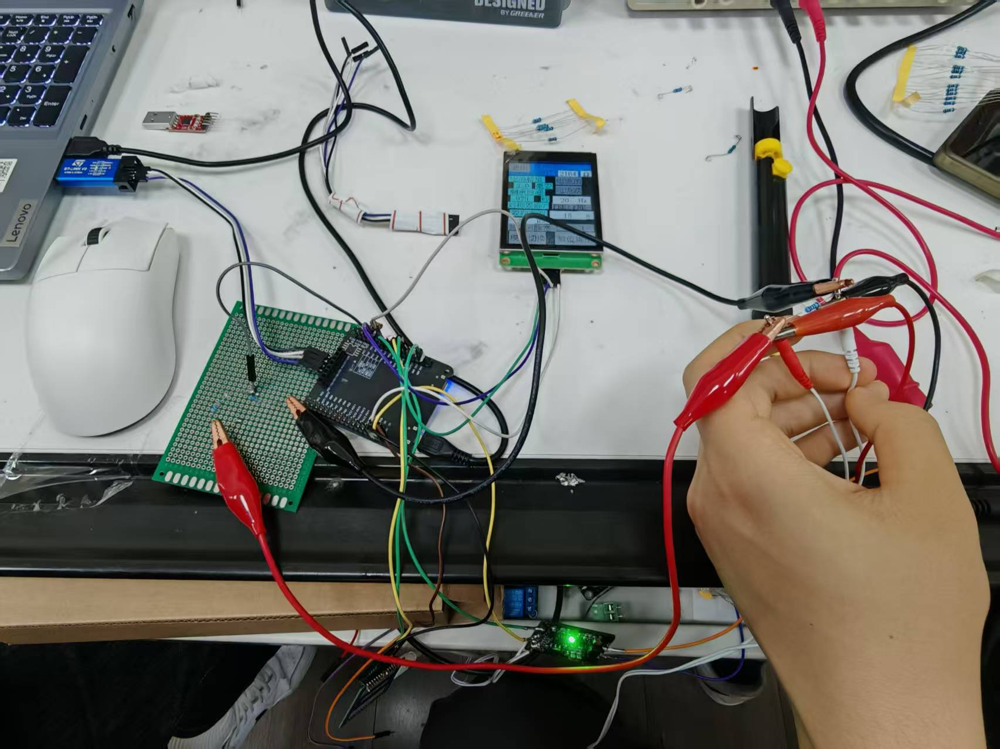
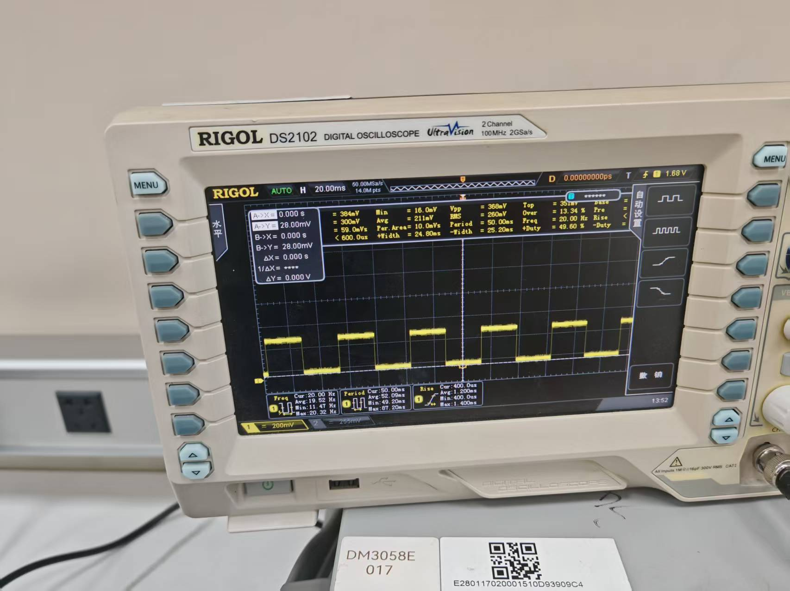
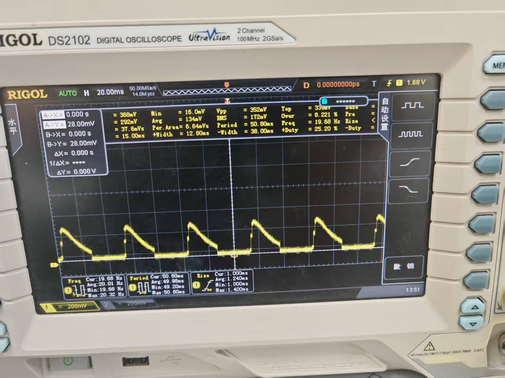

# 基于 STM32 的可编程电刺激教学原型

[English](README.md) · [实验记录](docs/validation.md) · [设计与实现](docs/医疗电刺激系统设计与实验报告.md) · [固件入口](firmware/README.md)

南京航空航天大学智能医疗实践课程项目。使用 STM32F103RCT6、Howland 恒流源、串口触屏和 ESP32-C3，完成波形输出、参数交互、阻抗估计与无线控制的原型联调。

维护者：**高申（Doooooooove）**。硬件搭建、焊接、固件集成、触屏与无线联调、示波器测量及标定由维护者独立完成，代码开发使用 AI 辅助。维护者已在 Keil 中完成编译，并完成原型实测。仓库公开代码、硬件资料和课程答辩中的实测记录。

> 本仓库用于教学与工程研究，验证材料以电阻负载台架为主。目前不声明临床有效性、医疗器械认证或 IEC 60601 合规。

## 实物与测量



课程答辩第 18 页的原型连线实拍。原图保留，未改变仪器画面或测试读数。

| 方波测量 | 平滑上升与指数衰减波测量 |
| --- | --- |
|  |  |

照片来自答辩第 7、10、15 页，可观察输出形态与约 20 Hz 的频率显示。探测节点、衰减比和电流换算记录未随照片完整提供，因此不据此推导输出电流精度或净电荷平衡。

## 已实现的工程内容

- **波形生成**：恒流、平滑上升加指数衰减、带直偏的两电平方波，以及固定周期的梯形包络演示模式。
- **标定与插值**：0–10 mA 对应 DAC 标定表，区间内线性插值。
- **阻抗估计**：ADC 均值采样、分压还原及 104.7 kΩ 并联支路补偿。
- **触屏交互**：参数设置、模式切换、状态显示与按模型绘制的波形预览。
- **无线控制**：ESP32-C3 建立 Wi-Fi 热点，网页通过串口下发方案、调节电流、切换启停和请求停止。

触屏波形由参数计算绘制，实际输出用外部仪器验证。无线实现为 Wi-Fi SoftAP + HTTP，当前代码未实现蓝牙控制。

## 架构与当前代码配置

```text
STM32 TIM1 → 波形计算 → DAC PA4 → Howland 恒流源 → 电阻负载
                                      ↓
                         100 kΩ / 4.7 kΩ → ADC PA0

USART2 PA2/PA3 ↔ 陶晶驰触屏
USART3 PB10/PB11 ↔ ESP32-C3 ↔ Wi-Fi 网页
```

| 模块 | 当前源码配置 | 实现位置 |
| --- | --- | --- |
| 波形更新 | TIM1：20 kHz，50 μs 时基 | [tim.c](firmware/STM32_YLDZ_Project/Core/Src/tim.c)、[中断回调](firmware/STM32_YLDZ_Project/Core/Src/main.c) |
| 电流与阻抗 | DAC1 PA4、ADC1_IN0 PA0 | [dac.c](firmware/STM32_YLDZ_Project/Core/Src/dac.c)、[adc.c](firmware/STM32_YLDZ_Project/Core/Src/adc.c) |
| 触屏串口 | USART2：PA2 TX、PA3 RX，9600 bps、8N1 | [usart.c](firmware/STM32_YLDZ_Project/Core/Src/usart.c) |
| 无线串口 | USART3：PB10 TX、PB11 RX，9600 bps、8N1 | [usart.c](firmware/STM32_YLDZ_Project/Core/Src/usart.c)、[main.lua](wireless/main.lua) |

2026-10-10 答辩材料使用 1 kHz 架构描述，当前源码使用 20 kHz。历史照片、标定表和当前固件的对应关系见[实验记录](docs/validation.md)。

## 标定记录

答辩第 8 页记录了 2.2 kΩ 标称负载、1–10 mA 的十个设定点。按表中电压重新计算，这组记录的最大绝对相对偏差约为 **0.0455%**。

该数值来自课程表格的转录与计算，未计入负载容差、仪器不确定度，也不代表全负载范围精度。第 16 页是另一组数据，单独保存，不合并为同一次测量。

- [第 8 页数据](data/defense-slide08-current-calibration.csv)
- [第 16 页数据](data/defense-slide16-current-calibration.csv)
- [计算方法与记录边界](docs/validation.md)

在仓库根目录运行即可复核计算，仅需 Python 3 标准库：

```sh
python3 tools/calibration_summary.py
```

## 编译与演示入口

1. 按[硬件说明](hardware/README.md)核对电源、负载和引脚。
2. 在 Keil MDK 中打开 `firmware/STM32_YLDZ_Project/MDK-ARM/YLDZ.uvprojx`，检查工具链与目标芯片，重新编译并烧录。
3. 按[触屏说明](hmi/README.md)编译 HMI 工程，确认屏幕串口为 9600 bps。
4. 按[无线说明](wireless/readme.md)加载 LuatOS 与 Lua 脚本，连接 `Medical-Stim` 热点后打开模块的网关地址。

仓库包含维护者的 HEX 构建产物。此次文档整理未重新构建固件，也未逐一核对 HEX 与源码的版本对应关系。当前源码上电即进入默认运行状态，倒计时归零会循环复位。演示前应先阅读[当前行为与待验证项](docs/validation.md#当前行为与待验证项)。

## 仓库导航

| 路径 | 内容 |
| --- | --- |
| [firmware/](firmware/README.md) | STM32 HAL 工程、核心控制与编译说明 |
| [hardware/](hardware/README.md) | 恒流源原理图与 PCB 资料 |
| [hmi/](hmi/README.md) | 陶晶驰触屏工程与字体 |
| [wireless/](wireless/readme.md) | ESP32-C3 LuatOS 网页与串口协议 |
| [docs/validation.md](docs/validation.md) | 照片来源、实验数据、版本差异及验证计划 |
| [docs/医疗电刺激系统设计与实验报告.md](docs/医疗电刺激系统设计与实验报告.md) | 按当前源码整理的设计说明 |
| [docs/portfolio.md](docs/portfolio.md) | 面向实习交流的项目简述 |

## 许可与资料来源

项目根目录包含 [MIT License](LICENSE)。STM32 HAL/CMSIS、LuatOS 固件和其他第三方材料各自保留原有许可及权利归属；根目录许可不覆盖第三方权利。

新增实物照片和标定转录来自维护者提供的课程答辩 PPT，逐项来源见 [docs/assets/README.md](docs/assets/README.md)。
