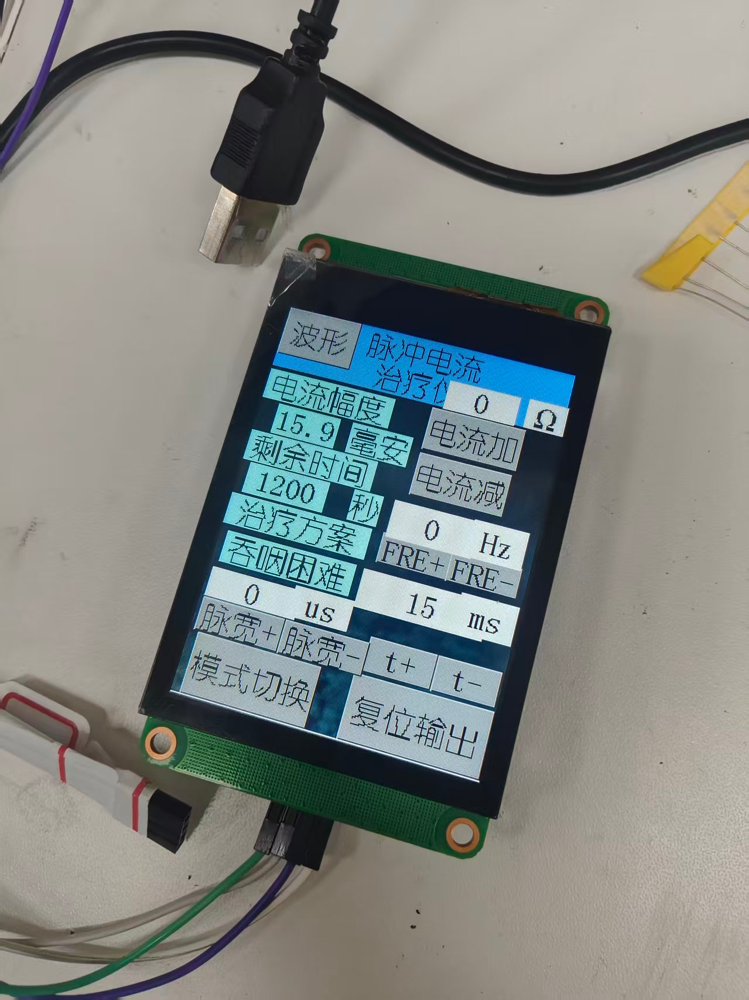

# 陶晶驰触屏工程

## 文件与通信

- `HMI32YLDZ.HMI`：串口屏编辑器工程。
- `gb2312-24.zi`：GB2312 字体。
- 答辩使用 3.2 英寸、320 × 240 串口屏，具体型号以工程设置及实物标签为准。
- 当前 STM32 端为 USART2：PA2 TX / PA3 RX，**9600 bps、8N1**。

## 编译与下载

1. 在匹配设备型号的陶晶驰串口屏编辑器中打开 HMI 工程。
2. 核对屏幕型号、页面和运行波特率，确保与 STM32 的 9600 bps 配置一致。
3. 编译生成 TFT 文件，按屏幕工具支持的 SD 卡或 USB-TTL 流程下载。
4. 在电阻负载台架检查模式切换、参数更新、波形页进入与返回。

此次助手整理没有重新通过串口屏编辑器打开或编译 HMI 二进制工程。

## 显示含义

图片来自答辩第 9 页，是历史界面照片，不能用图中单次显示值证明当前固件的量程或精度。

波形页通过 MCU 按参数计算曲线后发送显示，并非 ADC 实时采集的输出波形。频率、幅值和形状应以外部仪器在指定测点的记录交叉验证。

页面切换防抖和波形推流位于 STM32 的 `main.c`。已知实现与验证范围见[实验记录](../docs/validation.md)。
